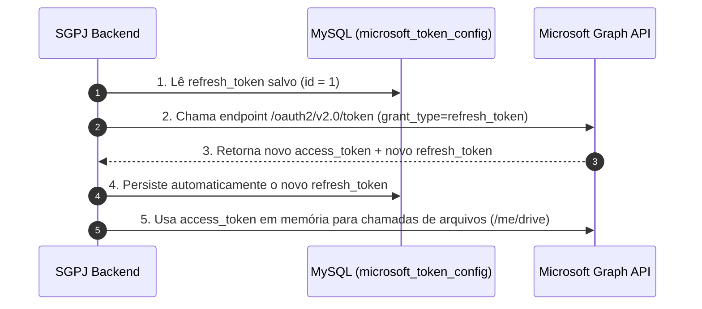
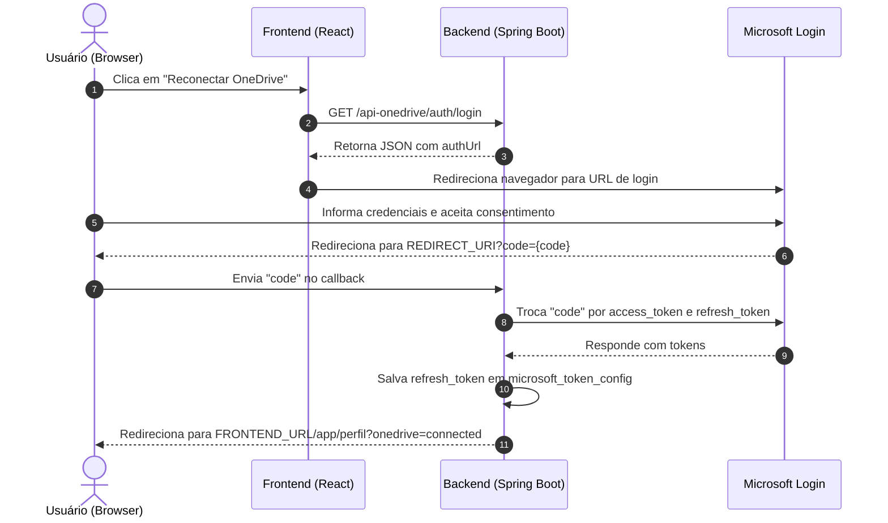
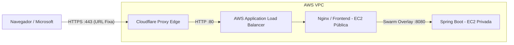

# SGPJ — Integração com OneDrive (Microsoft Graph)
## Integração com OneDrive e Fluxo de Reconexão
**Microsoft Graph API • Spring Boot • OAuth2 • Arquitetura de Nuvem AWS**  
*Documento Técnico Interno*

---

## 1. Visão Geral da Implementação

A integração com o Microsoft OneDrive fica concentrada em três componentes principais do backend:

1. **`OneDriveTokenAdapter`** — Obtém o `access_token`, renova com `refresh_token` e persiste a rotação do token no banco de dados.
2. **`MicrosoftTokenConfig`** — Entidade JPA que armazena e gerencia o `refresh_token` na tabela `microsoft_token_config`.
3. **`OneDriveService`** — Instancia o `GraphServiceClient` oficial da Microsoft e executa operações de manipulação de arquivos (criação de pastas, upload, download, renomeação, pré-visualização e exclusão).

### Fluxo de Execução Contínua



1. O backend lê o `refresh_token` salvo em `microsoft_token_config`.
2. `OneDriveTokenAdapter.renovarToken()` chama o endpoint de token da Microsoft com `grant_type=refresh_token`.
3. A Microsoft retorna um novo `access_token` e um novo `refresh_token` (rotação de credenciais).
4. O novo `refresh_token` é persistido automaticamente no banco.
5. `OneDriveService` usa o `access_token` em memória para chamar o Microsoft Graph.

---

## 2. Pré-requisitos de Conta

Para configurar o Microsoft Graph / OneDrive, é necessária uma conta Microsoft com acesso ao [Azure Portal](https://portal.azure.com).

### Tipos de conta aceitos:
* **Conta pessoal Microsoft** (ex: Outlook, Hotmail).
* **Conta educacional Microsoft 365 Education / Azure for Students**.
* **Conta corporativa vinculada a um tenant da organização**.

> [!NOTE]
> A Microsoft pode solicitar um cartão de crédito apenas para validar a identidade no portal. Isso não implica cobrança automática pela API. Em cenários educacionais (como Azure for Students), esse requisito costuma ser dispensado.

---

## 3. Custo e Cobrança

O uso da Microsoft Graph API para chamadas ao OneDrive **não é tarifado por requisição**. O aplicativo registrado opera sob os limites padrão de *throttling* do Microsoft Graph, controlados por aplicativo e por usuário.

### O que gera custo no Azure:
* Máquinas virtuais (VMs)
* Bancos de dados gerenciados
* Armazenamento de blobs/discos
* Serviços pagos adicionais de nuvem

> [!TIP]
> **Conclusão:** O registro de um App Registration para utilizar Microsoft Graph / OneDrive não gera custos financeiros para o projeto SGPJ.

---

## 4. Criando o App Registration no Azure

1. Acesse o **Microsoft Entra ID** (antigo Azure Active Directory) no [Azure Portal](https://portal.azure.com).
2. No menu lateral, acesse **App registrations** (Registros de aplicativo).
3. Clique em **New registration** (Novo registro).
4. Defina um nome identificador para a aplicação (ex: `SGPJ`).
5. Escolha o tipo de conta suportada:
   * **Single tenant:** Apenas contas deste diretório organizacional.
   * **Multitenant (Recomendado):** Contas em qualquer diretório organizacional e contas pessoais da Microsoft (ex: Skype, Xbox). No projeto SGPJ, utilizamos `tenant-id=common`, simplificando o fluxo para qualquer usuário.
6. Cadastre a **Redirect URI** (Plataforma Web):
   * **Desenvolvimento Local:** `http://localhost:8080/login/oauth2/code/azure`
   * **Produção (Nuvem):** Requer domínio fixo com protocolo HTTPS (veja detalhes na Seção 15).

> [!WARNING]
> O valor da `redirect_uri` precisa bater **exatamente caractere por caractere** com o cadastrado no Azure — incluindo protocolo (`http` vs `https`), domínio, porta e barras finais.

---

## 5. Gerando o Client Secret

1. No App Registration criado, acesse **Certificates & secrets** (Certificados e segredos).
2. Na aba *Client secrets*, clique em **New client secret**.
3. Defina uma descrição e escolha a validade desejada (6, 12 ou 24 meses).
4. Clique em **Add** e **copie imediatamente o valor do segredo (`Value`)**.

> [!CAUTION]
> O valor do *secret* só é exibido uma única vez. Quando ele expira, a renovação é manual: gere um novo segredo no portal e atualize as variáveis de ambiente do backend. Recomenda-se criar um alerta 30 dias antes do vencimento para evitar parada do serviço.

---

## 6. Configurando as Permissões da API

No App Registration, acesse **API permissions** → **Add a permission** → **Microsoft Graph** → **Delegated permissions** e adicione:

| Permissão | Tipo | Finalidade |
| :--- | :--- | :--- |
| `User.Read` | Delegada | Permite ler o perfil básico do usuário autenticado (`/me`). |
| `Files.ReadWrite.All` | Delegada | Leitura e gravação completa nos arquivos e pastas do OneDrive. |
| `offline_access` | Delegada | **Essencial:** Permite obter e renovar o `refresh_token` por tempo indeterminado. |

> [!NOTE]
> A permissão `Sites.Read.All` não é necessária pois o fluxo consome o drive pessoal do usuário (`/me/drive`).
> Se a organização exigir, clique em **Grant admin consent** (Conceder consentimento do administrador) para liberar o uso geral.

---

## 7. Propriedades no `application.properties`

As configurações do backend ficam parametrizadas em `src/main/resources/application.properties`:

```properties
# Microsoft Graph / OneDrive
microsoft.client-id=${CLIENT_ID}
microsoft.client-secret=${CLIENT_SECRET}
microsoft.tenant-id=${TENANT_ID:common}
microsoft.redirect-uri=${REDIRECT_URI:http://localhost:8080/login/oauth2/code/azure}
app.frontend-url=${FRONTEND_URL:http://localhost:5173}
```

> [!IMPORTANT]
> Em produção, essas credenciais devem ser injetadas exclusivamente via variáveis de ambiente do sistema operacional ou secrets do Docker/Ansible. Nunca comite chaves no repositório Git.

---

## 8. Fluxo de Autenticação Inicial

O fluxo implementado segue a especificação **OAuth2 Authorization Code Flow**:



---

## 9. Fluxo de Refresh Automático

O `OneDriveTokenAdapter` realiza a renovação automática sempre que o `access_token` em memória não existir ou estiver a menos de 5 minutos da expiração:

1. Consulta o registro `id = 1` na tabela `microsoft_token_config`.
2. Submete o `refresh_token` ao endpoint da Microsoft com `grant_type=refresh_token`.
3. Atualiza `accessToken` e `expiresAt` na memória da aplicação.
4. Salva o novo `refresh_token` retornado no banco de dados.

> [!WARNING]
> Caso a Microsoft responda com `invalid_grant` (refresh token expirado ou revogado), o sistema lança `OneDriveErroException`, informando na interface que é necessária a reconexão manual pelo usuário.

---

## 10. Por que o Refresh Token Pode Invalidar?

| # | Causa da Invalidação | Ação Necessária |
| :-: | :--- | :--- |
| **1** | Período de inatividade contínua superior a 90 dias | Reconexão manual na tela de perfil |
| **2** | Revogação manual pelo próprio usuário no portal da Microsoft | Reconexão manual |
| **3** | Alteração de senha da conta Microsoft | Reconexão manual |
| **4** | Políticas de *Conditional Access* da organização | Alinhamento com administrador de TI |
| **5** | Consentimento revogado pelo administrador do Tenant | Conceder novo consentimento |
| **6** | Falha de sincronização de banco de dados entre ambientes | Rodar reconexão para atualizar registro |

---

## 11. Endpoints de Reconexão Disponíveis

| Método | Endpoint | Visibilidade | Finalidade |
| :--- | :--- | :--- | :--- |
| `GET` | `/api-onedrive/auth/login` | Privado (`ADMIN`) | Retorna JSON contendo a URL de autorização da Microsoft. |
| `GET` | `/api-onedrive/auth/login/redirect` | Privado (`ADMIN`) | Redirecionamento HTTP 302 direto para o login da Microsoft. |
| `GET` | `/api-onedrive/auth/callback` | Público | Recebe o `code` da Microsoft, troca pelos tokens e redireciona ao frontend. |
| `GET` | `/login/oauth2/code/azure` | Público | Endpoint legado de callback registrado previamente no Azure. |

### Resposta de Sucesso do Backend:
Quando finalizado via API REST:
```json
{
  "message": "OneDrive reconectado com sucesso.",
  "status": "connected"
}
```

---

## 12. Como Validar a Reconexão Localmente

1. No navegador ou via Swagger, acione `GET /api-onedrive/auth/login` e abra a `authUrl` gerada.
2. Efetue o login e aceite os consentimentos da conta Microsoft.
3. Observe o retorno no frontend (`/app/perfil?onedrive=connected`).
4. Valide a persistência no banco MySQL:
   ```sql
   SELECT id, refresh_token, data_criacao 
   FROM microsoft_token_config 
   WHERE id = 1;
   ```
5. Realize testes de upload ou listagem de pastas no SGPJ.

---

## 13. Observações Operacionais

1. O endpoint de callback precisa permanecer acessível publicamente no filtro de segurança do Spring Boot (`SecurityFilterChain`), pois a Microsoft o invoca via navegador sem token Bearer prévio.
2. A inicialização da URL de login (`/login`) deve permanecer restrita a usuários administradores autenticados.
3. O redirecionamento após a troca do código respeita a variável `${app.frontend-url}`.

---

## 14. Referências e Links Úteis

* **Microsoft Graph — Visão Geral:** [learn.microsoft.com/graph/overview](https://learn.microsoft.com/pt-br/graph/overview)
* **OneDrive API — Conceitos:** [learn.microsoft.com/graph/onedrive-concept-overview](https://learn.microsoft.com/pt-br/graph/onedrive-concept-overview)
* **OAuth2 Authorization Code Flow:** [learn.microsoft.com/entra/identity-platform/v2-oauth2-auth-code-flow](https://learn.microsoft.com/pt-br/entra/identity-platform/v2-oauth2-auth-code-flow)
* **Ciclo de Vida do Refresh Token:** [learn.microsoft.com/entra/identity-platform/refresh-tokens](https://learn.microsoft.com/pt-br/entra/identity-platform/refresh-tokens)
* **Microsoft Graph Java SDK v6:** [github.com/microsoftgraph/msgraph-sdk-java](https://github.com/microsoftgraph/msgraph-sdk-java)
* **Decodificador de Tokens JWT:** [jwt.ms](https://jwt.ms)
* **Códigos de Erro AADSTS:** [learn.microsoft.com/entra/identity-platform/reference-error-codes](https://learn.microsoft.com/pt-br/entra/identity-platform/reference-error-codes)

---

## 15. Transição do Ambiente Localhost para Nuvem (AWS & Produção)

Esta seção detalha o comportamento da integração ao sair do ambiente de desenvolvimento local (`localhost`) para uma infraestrutura em nuvem na AWS provisionada com **Terraform**, **Docker Swarm** e **Application Load Balancer (ALB)**.

### 15.1 Por que Funciona no `localhost`?
Em desenvolvimento local, o Azure aceita `http://localhost:8080/login/oauth2/code/azure` devido a uma **exceção explícita da RFC 8252** para desenvolvimento em loopback. O navegador roda na mesma máquina do servidor Spring Boot, dispensando certificados SSL.

---

### 15.2 Desafios Críticos Encontrados na Nuvem (AWS)

#### 1. Exigência Mandatória de HTTPS pela Microsoft
Ao cadastrar um endereço externo no portal do Azure Entra ID, a plataforma impõe a seguinte restrição:
> **"Deve começar com HTTPS ou http://localhost. Deve ser uma URL válida."**

A Microsoft **rejeita sumariamente** qualquer URL que use `http://` puro fora de `localhost`. Portanto, links HTTP do tipo `http://alb-app-xxx.elb.amazonaws.com` não são aceitos pelo portal.

#### 2. O Problema da Efemeridade do DNS do Load Balancer (ALB)
Ao gerenciar infraestrutura com Terraform, é padrão executar ciclos de `terraform destroy` e `terraform apply` (especialmente em ambientes acadêmicos e laboratórios):
* A cada novo `terraform apply`, a AWS gera um **novo nome de DNS aleatório** para o ALB (ex: `alb-app-184920482.us-east-1.elb.amazonaws.com`).
* **Impacto:** Seria necessário acessar o portal do Azure a cada deploy, cadastrar o novo endereço de redirecionamento e reiniciar os containers com as novas variáveis. Esse processo é inviável e propenso a erros.

#### 3. Limitação de Certificados SSL da AWS (ACM)
O AWS Certificate Manager (ACM) **não emite certificados SSL públicos para domínios padrão da AWS**, como `*.elb.amazonaws.com` ou `*.compute.amazonaws.com`. O ACM exige comprovação de posse de um domínio próprio (ex: `.com.br`, `.com`). Consequentemente, não é possível criar um listener HTTPS (porta 443) no ALB apontando para o DNS cru da AWS sem um domínio.

#### 4. Isolamento de Rede e Proxy Reverso (Docker Swarm)
Na infraestrutura SGPJ:
* O backend roda em instâncias EC2 dentro de sub-redes **privadas** (sem IP público).
* As requisições externas chegam pelo ALB e entram pelo **Nginx das instâncias públicas** (Frontend).
* Para que o callback da Microsoft funcione, o Nginx precisa rotear os caminhos `/login/oauth2/` e `/api-onedrive/` diretamente para o serviço interno `http://api.backend:8080/`.

---

### 15.3 Arquitetura de Solução Recomendada: Domínio Fixo + Cloudflare

A abordagem mais econômica, robusta e padrão de mercado para resolver o HTTPS e a efemeridade do ALB sem custos adicionais:



#### Como Funciona:
1. **Domínio Fixo:** Registra-se um domínio (ex: `sgpj.com.br` ou subdomínio).
2. **Cadastro Único no Azure:** No Azure Entra ID, cadastra-se uma única vez a URL segura:
   ```text
   https://app.sgpj.com.br/login/oauth2/code/azure
   ```
3. **Proxy Cloudflare (SSL Gratuito):**
   * O Cloudflare fornece certificado SSL/TLS automático de ponta a ponta para o usuário.
   * Ele se comunica com o ALB da AWS pela porta 80 (HTTP).
4. **Ciclos de Deploy com Terraform:**
   * Quando o ALB for destruído e recriado, **apenas o registro CNAME no Cloudflare é atualizado** (o que pode ser automatizado via provider Cloudflare do Terraform).
   * As credenciais no Azure e o código do sistema **nunca precisam ser alterados**.

---

### 15.4 Arquitetura Alternativa: Route 53 + AWS Certificate Manager (ACM)

Caso a organização mantenha um domínio registrado sob gestão da própria AWS:

1. **Solicitação do Certificado:** O Terraform cria o recurso `aws_acm_certificate` para o domínio e valida via registros DNS no Route 53.
2. **Listener HTTPS no ALB:** Adiciona-se o listener na porta 443 no arquivo `ec2.tf`:
   ```hcl
   resource "aws_lb_listener" "https" {
     load_balancer_arn = aws_lb.app.arn
     port              = 443
     protocol          = "HTTPS"
     ssl_policy        = "ELBSecurityPolicy-TLS13-1-2-2021-06"
     certificate_arn   = aws_acm_certificate_validation.cert.certificate_arn

     default_action {
       type             = "forward"
       target_group_arn = aws_lb_target_group.app.arn
     }
   }
   ```
3. **Alias no Route 53:** Um registro de Alias aponta o domínio fixo diretamente para o `aws_lb.app.dns_name`.

---

### 15.5 Matriz Comparativa: Localhost vs. Nuvem

| Critério | Ambiente Localhost | Nuvem AWS (Produção) |
| :--- | :--- | :--- |
| **Protocolo Aceito** | HTTP simples (`http://localhost:8080`) | **Obrigatoriamente HTTPS** (`https://...`) |
| **Estabilidade de URL** | Fixa (`localhost`) | Efêmera no ALB; Fixa via Domínio/DNS |
| **Certificado SSL** | Não aplicável | Exigido (Cloudflare Edge ou AWS ACM) |
| **Caminho de Rede** | Direto (Browser ↔ Spring Boot) | Browser → ALB → Nginx Frontend → Swarm Backend |
| **Configuração no Azure** | `http://localhost:8080/login/oauth2/code/azure` | `https://<DOMINIO_FIXO>/login/oauth2/code/azure` |
| **Tempo de Manutenção** | Zero em reinicializações | Zero se utilizado domínio fixo |

---

### 15.6 Checklist de Configurações Técnicas para Produção

Quando a infraestrutura for apontada para um domínio de produção com HTTPS:

- [ ] **Azure App Registration:** Adicionar a URL `https://<DOMINIO>/login/oauth2/code/azure` na lista de URIs de Redirecionamento Web.
- [ ] **Template Swarm (`stack.yml.j2`):** Injetar as variáveis de ambiente no container Backend:
  ```yaml
  REDIRECT_URI: "https://<DOMINIO>/login/oauth2/code/azure"
  FRONTEND_URL: "https://<DOMINIO>"
  COOKIE_SECURE: "true"
  ```
- [ ] **Configuração do Nginx (`Frontend/nginx.conf`):** Garantir o proxy das rotas de autenticação:
  ```nginx
  location /login/oauth2/ {
      proxy_pass http://api.backend:8080/login/oauth2/;
      proxy_set_header Host $host;
      proxy_set_header X-Real-IP $remote_addr;
      proxy_set_header X-Forwarded-For $proxy_add_x_forwarded_for;
      proxy_set_header X-Forwarded-Proto $scheme;
  }

  location /api-onedrive/ {
      proxy_pass http://api.backend:8080/api-onedrive/;
      proxy_set_header Host $host;
      proxy_set_header X-Real-IP $remote_addr;
      proxy_set_header X-Forwarded-For $proxy_add_x_forwarded_for;
      proxy_set_header X-Forwarded-Proto $scheme;
  }
  ```
- [ ] **Ambiente Local:** Enquanto em desenvolvimento, manter os apontamentos locais padrão intactos (`http://localhost:8080` e `http://localhost:5173`), assegurando total compatibilidade sem impacto no fluxo de desenvolvimento da equipe.
