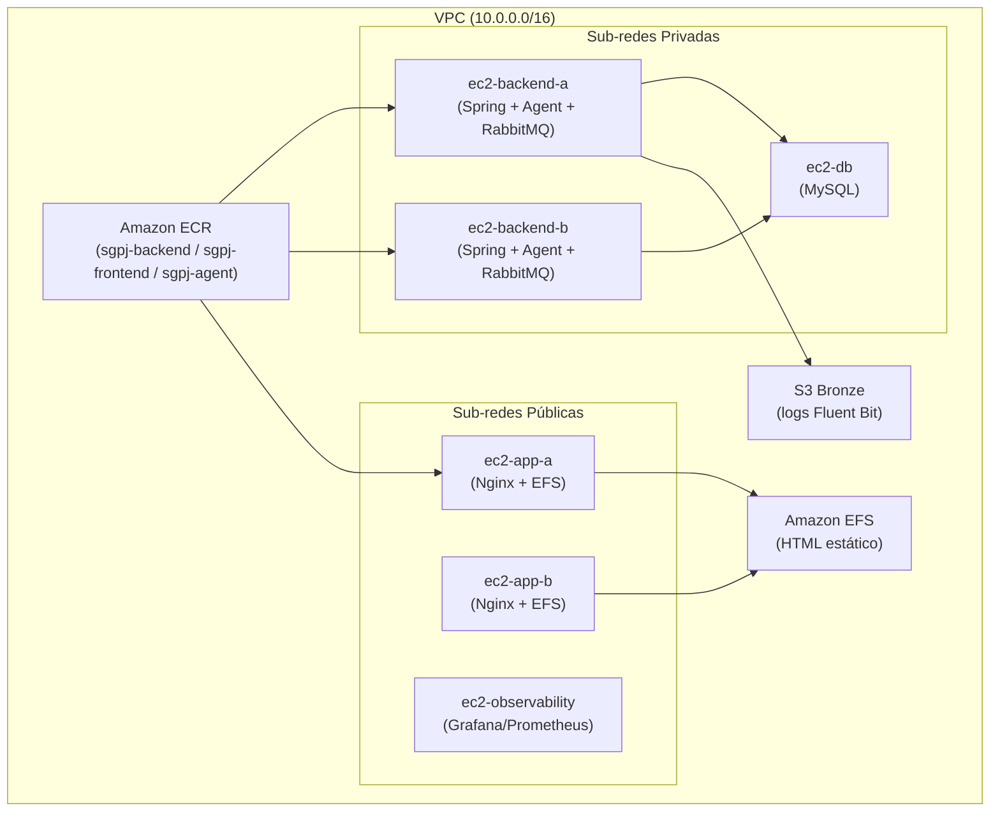
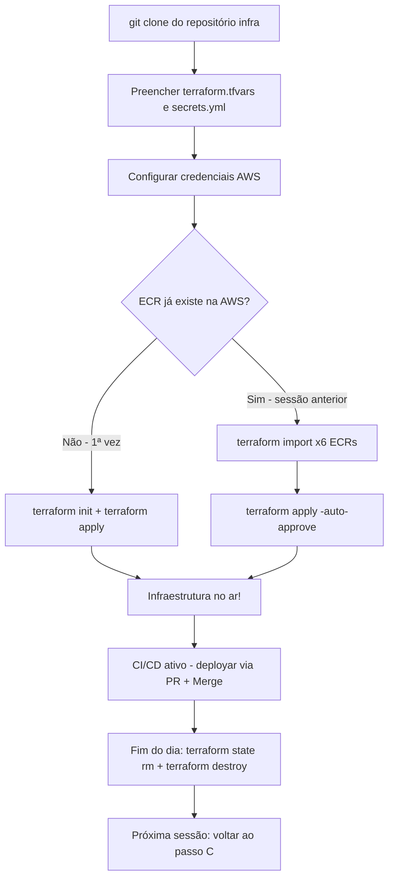

# Guia Definitivo de Execução e Implantação da Infraestrutura — SGPJ

> [!IMPORTANT]
> Este guia foi elaborado para que **qualquer membro do grupo** consiga clonar o repositório em sua própria máquina (Windows com WSL ou Linux puro) e subir a infraestrutura completa na AWS sem erros de caminhos fixos ou arquivos ausentes.

---

## Visão Geral da Arquitetura

O projeto SGPJ utiliza a seguinte stack de infraestrutura:

| Componente | Tecnologia |
|---|---|
| Orquestração de containers | Docker Compose (nas EC2s) |
| Repositório de imagens | Amazon ECR (3 repositórios: `sgpj-backend`, `sgpj-frontend`, `sgpj-agent`) |
| IA Conversacional | Agent MarIA (Python + LangChain + Gemini) |
| Observabilidade | Grafana + Prometheus + Loki + Alertmanager |
| Pipeline de Logs | Fluent Bit → S3 Bronze → Athena |
| CI/CD | GitHub Actions (CI: testes, CD: build Docker + push ECR + deploy via SSM) |



---

## 1. Pré-requisitos na Máquina Local

Para executar este projeto, a sua máquina precisa ter instalado:

1. **Git**
2. **AWS CLI v2** configurado com as credenciais do seu laboratório Vocareum.
3. **Terraform** (versão 1.5.0 ou superior).
4. **WSL (Ubuntu)** com **Ansible** instalado:
   ```bash
   # Dentro do WSL (Ubuntu):
   sudo apt update
   sudo apt install -y ansible python3-pip
   ```
5. A chave privada do laboratório AWS Academy (`vockey.pem`).

> [!NOTE]
> Se você já tem Terraform e Ansible instalados (como ferramentas globais no PATH), não precisa reinstalá-los. Apenas verifique as versões com `terraform version` e `ansible --version`.

---

## 2. Preparação do Ambiente (Passo a Passo)

### Passo 2.1 — Configurar a Chave SSH (`vockey.pem`)

No AWS Academy, baixe o arquivo `vockey.pem` (ou `labsuser.pem`) e salve-o no diretório `~/.ssh/` do seu WSL:

```bash
# No terminal WSL:
mkdir -p ~/.ssh
# Copie o arquivo vockey.pem que você baixou na pasta Downloads do Windows:
# (substitua $USER pelo seu usuário real, ex: /mnt/c/Users/joao/Downloads/vockey.pem)
cp /mnt/c/Users/$USER/Downloads/vockey.pem ~/.ssh/vockey.pem
# Ajuste as permissões de segurança obrigatórias do SSH:
chmod 400 ~/.ssh/vockey.pem
```

---

### Passo 2.2 — Configurar as Variáveis do Terraform (`terraform.tfvars`)

Dentro da pasta `infra/terraform/`, existe um arquivo de exemplo. Crie a sua cópia local:

```bash
cd infra/terraform
cp terraform.tfvars.example terraform.tfvars
```

Abra o `terraform.tfvars` e preencha os valores:

| Variável | Descrição | Exemplo |
|---|---|---|
| `Key-All` | Nome do par de chaves na AWS | `"vockey"` |
| `auto_run_ansible` | Rodar Ansible automaticamente após `apply` | `true` |
| `enable_observability` | Subir instância Grafana/Prometheus | `false` |

> [!NOTE]
> O arquivo `terraform.tfvars` está no `.gitignore` — ele nunca será commitado. Cada membro do grupo precisa criar o seu próprio a partir do `.example`.

---

### Passo 2.3 — Configurar os Segredos da Aplicação (`secrets.yml`)

Dentro de `infra/ansible/`, crie o arquivo de segredos a partir do exemplo fornecido:

```bash
cd infra/ansible
cp secrets.yml.example secrets.yml
```

Abra o `secrets.yml` e preencha todas as variáveis:

| Campo | Descrição |
|---|---|
| `jwt_secret` | Chave secreta para assinar tokens JWT (mínimo 32 caracteres) |
| `azure_client_id` | Client ID do aplicativo Azure AD (OAuth Google/Microsoft) |
| `azure_client_secret` | Client Secret do Azure AD |
| `azure_tenant_id` | Tenant ID do Azure AD |
| `mail_username` | E-mail do Gmail usado para notificações |
| `mail_password` | Senha de aplicativo do Gmail (não a senha da conta) |
| `llm_api_key` | Chave da API Gemini (Google AI Studio) |

> [!CAUTION]
> **Nunca** commite o `secrets.yml` real. Ele está no `.gitignore`. Se acidentalmente commitar, revogue as chaves imediatamente.

---

### Passo 2.4 — Configurar Credenciais da AWS no Terminal

> [!WARNING]
> As credenciais do AWS Academy **expiram a cada ~4 horas**. Repita este passo toda vez que abrir uma nova sessão no Vocareum.

1. Vá em **AWS Details** ➔ **AWS CLI** ➔ copie o bloco de credenciais.
2. Cole no seu terminal PowerShell ou WSL:

```bash
aws configure set aws_access_key_id "SUA_ACCESS_KEY"
aws configure set aws_secret_access_key "SUA_SECRET_KEY"
aws configure set aws_session_token "SEU_SESSION_TOKEN"
aws configure set region "us-east-1"
```

3. Verifique se funcionou:
```bash
aws sts get-caller-identity
```

---

## 3. Primeira Vez — Criando os Repositórios ECR e Toda a Infraestrutura

> [!NOTE]
> Execute esta seção apenas se for a **primeira vez** que o grupo está rodando o projeto. Os repositórios ECR ainda não existem na sua conta AWS.

```bash
cd infra/terraform
terraform init
terraform apply -auto-approve
```

### O que o Terraform faz automaticamente:

1. **Cria os repositórios ECR:** `sgpj-backend`, `sgpj-frontend`, `sgpj-agent`
2. **Cria a rede completa na AWS:** VPC, Subnets Públicas e Privadas, Internet Gateway, NAT Gateway, Route Tables e Security Groups (incluindo NACLs).
3. **Cria o armazenamento:** Sistema de Arquivos EFS compartilhado e Buckets S3 do Data Lake (Bronze, Silver, Gold).
4. **Cria as instâncias EC2:**
   - `ec2-app-a` e `ec2-app-b` (Nginx / Frontend).
   - `ec2-backend-a` e `ec2-backend-b` (Spring Boot + RabbitMQ + Agent Python).
   - `ec2-db` (Banco MySQL).
5. **Gera os arquivos do Ansible:** Monta dinamicamente os IPs reais no `production.ini` e as variáveis no `all.yml`.
6. **Executa o Ansible (se `auto_run_ansible = true`):** Entra nas máquinas, instala o Docker, monta o EFS, sobe o MySQL e inicia os containers.

---

## 4. Dia a Dia — Destruir e Recriar a Infraestrutura

> [!IMPORTANT]
> Os repositórios ECR têm `prevent_destroy = true` para proteger as imagens Docker. Isso significa que `terraform destroy` **vai falhar** se tentar deletar os ECRs. Siga **obrigatoriamente** o fluxo abaixo.

---

### 4.1 — Para DESTRUIR (fim do dia / economizar créditos)

```powershell
cd infra/terraform

# PASSO 1: Remover os ECRs do estado do Terraform
# (isso NÃO apaga os repositórios na AWS, apenas desvincula do estado local)
terraform state rm `
  aws_ecr_lifecycle_policy.agent `
  aws_ecr_lifecycle_policy.frontend `
  aws_ecr_lifecycle_policy.backend `
  aws_ecr_repository.frontend `
  aws_ecr_repository.backend `
  aws_ecr_repository.agent

# PASSO 2: Destruir toda a infraestrutura restante
terraform destroy -auto-approve
```

> [!NOTE]
> Após o destroy, os repositórios ECR **continuam existindo** na AWS com todas as imagens intactas. Apenas as EC2s, VPC, EFS, etc., são destruídos.

---

### 4.2 — Para RECRIAR (início de nova sessão)

```powershell
cd infra/terraform

# PASSO 1: Atualizar credenciais AWS (veja Seção 2.4)
# aws configure set aws_access_key_id "..."  (etc.)

# PASSO 2: Reconectar o Terraform aos ECRs existentes na AWS
terraform import aws_ecr_repository.frontend sgpj-frontend
terraform import aws_ecr_repository.backend sgpj-backend
terraform import aws_ecr_repository.agent sgpj-agent
terraform import aws_ecr_lifecycle_policy.frontend sgpj-frontend
terraform import aws_ecr_lifecycle_policy.backend sgpj-backend
terraform import aws_ecr_lifecycle_policy.agent sgpj-agent

# PASSO 3: Recriar toda a infraestrutura
terraform apply -auto-approve
```

> [!WARNING]
> Se você pular o `terraform import` e rodar direto o `apply`, o Terraform vai tentar **criar novos repositórios ECR** com o mesmo nome e vai dar erro de conflito, pois eles já existem na AWS.

---

## 5. O Novo Fluxo com CI/CD (GitHub Actions)

Agora que o CI/CD está implementado, **ninguém mais precisa fazer deploy manual**:


### Como atualizar código no dia a dia:

1. Crie uma branch para sua funcionalidade: `git checkout -b feat/minha-feature`
2. Desenvolva seu código e faça commit.
3. Abra um **Pull Request** para a `main`.
4. Os testes unitários vão rodar sozinhos na nuvem (CI).
5. Ao aprovar o PR e fazer o **Merge** (use **Squash and Merge**), o GitHub Actions:
   - Gera a nova imagem Docker.
   - Envia para o Amazon ECR.
   - Atualiza os containers nas EC2s automaticamente via AWS SSM.

### Configuração dos Segredos no GitHub (por repositório)

> [!IMPORTANT]
> As credenciais AWS precisam estar configuradas como **Secrets** (não Variables) em **cada repositório** separadamente. Acesse: `Settings → Secrets and variables → Actions → New repository secret`
>
> Como as credenciais do Vocareum expiram a cada ~4h, **atualize os 3 secrets** no início de cada sessão:
> - `AWS_ACCESS_KEY_ID`
> - `AWS_SECRET_ACCESS_KEY`
> - `AWS_SESSION_TOKEN`

---

## 6. Observabilidade (Grafana + Prometheus + Loki)

> [!NOTE]
> A observabilidade só está disponível se `enable_observability = true` no `terraform.tfvars`.

Obtenha o IP público da instância de observabilidade:

```bash
cd infra/terraform
terraform output observability_public_ip
```

| Serviço | URL | Credenciais |
|---|---|---|
| **Grafana** | `http://<IP>:3001` | admin / admin |
| **Prometheus** | `http://<IP>:9090` | — |
| **Alertmanager** | `http://<IP>:9093` | — |

- **Loki** coleta logs de todos os containers Docker das EC2s.
- **Prometheus** coleta métricas via Node Exporter (CPU, memória, disco) de todas as instâncias.
- Os dashboards do Grafana já estão pré-configurados via provisionamento automático do Ansible.

---

## 7. Pipeline de Logs com Fluent Bit + Athena

O Fluent Bit é instalado automaticamente pelo Ansible em todas as EC2s e coleta:

- Logs de containers Docker
- Logs do Nginx
- Logs de acesso SSH (auditoria)

Os logs são enviados para o **S3 Bronze Bucket** (`sgpj-bronze-<account-id>`).

### Configuração do Athena

| Item | Valor |
|---|---|
| **Workgroup** | `sgpj-logs-analytics` |
| **Database** | `sgpj_logs_bronze` |
| **Script de criação das tabelas** | `infra/scripts/athena/create_tables.sql` |

### Queries pré-construídas disponíveis:

- Erros de aplicação (últimas 24h)
- Estatísticas de acesso Nginx (top rotas, status codes)
- Auditoria de SSH (logins, tentativas falhas)

Para criar as tabelas pela primeira vez, execute o script no console Athena da AWS ou via CLI:

```bash
aws athena start-query-execution \
  --query-string file://infra/scripts/athena/create_tables.sql \
  --work-group sgpj-logs-analytics \
  --region us-east-1
```

---

## 8. Verificação e Troubleshooting

### 8.1 — Verificar o estado das EC2s após o `apply`

```bash
# Listar instâncias em execução
aws ec2 describe-instances \
  --filters "Name=instance-state-name,Values=running" \
  --query "Reservations[*].Instances[*].{Name:Tags[?Key=='Name']|[0].Value,IP:PublicIpAddress,PrivateIP:PrivateIpAddress}" \
  --output table
```

### 8.2 — Acessar as EC2s via SSH

As EC2s de backend ficam em **sub-rede privada** — acesse via bastion (ec2-app-a):

```bash
# 1. Primeiro, conecte ao bastion (ec2-app-a — sub-rede pública)
ssh -i ~/.ssh/vockey.pem ubuntu@<IP_PUBLICO_APP_A>

# 2. De dentro do bastion, conecte ao backend
ssh -i ~/.ssh/vockey.pem ubuntu@<IP_PRIVADO_BACKEND>
```

> [!TIP]
> Os IPs das instâncias mudam a cada sessão do laboratório. Use `terraform output` ou o console AWS para obter os IPs atuais:
> ```bash
> cd infra/terraform
> terraform output
> ```

### 8.3 — Verificar containers em execução

```bash
# Dentro de qualquer EC2:
docker ps

# Ver logs do Agent MarIA:
docker logs -f --tail 50 sgpj-agent

# Verificar saúde do Agent:
curl -s http://localhost:8000/health

# Ver logs do backend Spring Boot:
docker logs -f --tail 50 sgpj-backend

# Ver logs do RabbitMQ:
docker logs -f --tail 50 rabbitmq
```

### 8.4 — Reiniciar containers manualmente (se necessário)

```bash
# No backend EC2:
cd /opt/app-backend
docker compose down
docker compose pull   # baixa a imagem mais recente do ECR
docker compose up -d
```

### 8.5 — Problemas comuns

| Problema | Causa Provável | Solução |
|---|---|---|
| `terraform apply` falha com "ECR already exists" | ECR já existe na AWS mas não está no estado local | Execute os `terraform import` da Seção 4.2 |
| `terraform destroy` falha com "prevent_destroy" | O Terraform está tentando destruir o ECR | Execute o `terraform state rm` da Seção 4.1 primeiro |
| CI/CD falha com "Credentials could not be loaded" | Secrets AWS expirados ou configurados como Variables | Atualize os 3 Secrets no GitHub (ver Seção 5) |
| SSM `InvalidInstanceId` | IDs das EC2s mudaram (nova sessão Vocareum) | O pipeline já faz descoberta dinâmica por tag — verifique se as EC2s estão em execução |
| `docker pull` falha nas EC2s | Credenciais ECR expiradas | O Ansible/CI roda `aws ecr get-login-password` automaticamente |

---

## 9. Integração com OneDrive (Nota de Ambiente)

> [!NOTE]
> Esta nota é relevante para membros que têm o repositório clonado dentro de uma pasta sincronizada com OneDrive.

- **Localmente (localhost):** O projeto funciona normalmente mesmo com o repositório dentro do OneDrive.
- **Na AWS (produção):** A comunicação entre os serviços usa HTTPS e nomes de domínio — não há dependência de caminhos locais.
- **Variáveis de ambiente:** Todas as configurações sensíveis estão nos arquivos `secrets.yml` e `terraform.tfvars` que ficam **fora** do controle de versão. Nunca deixe esses arquivos serem sincronizados com o OneDrive de outros membros — cada pessoa tem os seus próprios.

---

## Resumo do Fluxo Completo


