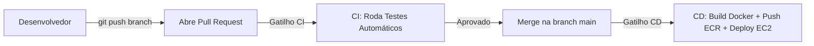

# Guia Definitivo de Execução e Implantação da Infraestrutura — SGPJ

> [!IMPORTANT]
> Este guia foi elaborado para que **qualquer membro do grupo** consiga clonar o repositório em sua própria máquina (Windows com WSL ou Linux puro) e subir a infraestrutura completa na AWS sem erros de caminhos fixos ou arquivos ausentes.

---

## 1. Pré-requisitos na Máquina Local

Para executar este projeto, a sua máquina precisa ter instalado:
1. **Git**
2. **AWS CLI v2** configurado com as credenciais do seu laboratório Vocareum.
3. **Terraform** (versão 1.5.0 ou superior).
4. **WSL (Ubuntu)** com **Ansible** instalado:
   ```bash
   # Dentro do WSL (Ubuntu):
   sudo apt update
   sudo apt install -y ansible python3-pip
   ```
5. A chave privada do laboratório AWS Academy (`vockey.pem`).

---

## 2. Preparação do Ambiente (Passo a Passo)

### Passo 2.1 — Configurar a Chave SSH (`vockey.pem`)
No AWS Academy, baixe o arquivo `vockey.pem` (ou `labsuser.pem`) e salve-o no diretório `~/.ssh/` do seu WSL:

```bash
# No terminal WSL:
mkdir -p ~/.ssh
# Copie o arquivo vockey.pem que você baixou na pasta Downloads do Windows:
cp /mnt/c/Users/$USER/Downloads/vockey.pem ~/.ssh/vockey.pem
# Ajuste as permissões de segurança obrigatórias do SSH:
chmod 400 ~/.ssh/vockey.pem
```

---

### Passo 2.2 — Configurar as Variáveis do Terraform (`terraform.tfvars`)
Dentro da pasta `infra/terraform/`, existe um arquivo de exemplo. Crie a sua cópia local:

```bash
cd infra/terraform
cp terraform.tfvars.example terraform.tfvars
```

> [!TIP]
> O arquivo `terraform.tfvars` contém configurações como:
> - `Key-All = "vockey"` (nome da chave na AWS)
> - `auto_run_ansible = true` (executa a configuração dos servidores automaticamente após criar a infra)
> - `enable_observability = false` (mude para `true` se quiser subir o Grafana)

---

### Passo 2.3 — Configurar os Segredos da Aplicação (`secrets.yml`)
Dentro de `infra/ansible/`, crie o arquivo de segredos a partir do exemplo fornecido:

```bash
cd ../ansible
cp secrets.yml.example secrets.yml
```

Abra o arquivo `secrets.yml` e preencha as variáveis da aplicação (JWT Secret, Azure OAuth, credenciais do Gmail SMTP, etc.). 

---

### Passo 2.4 — Configurar Credenciais da AWS no Terminal
Sempre que você abrir um novo laboratório no Vocareum:
1. Vá em **AWS Details** ➔ **AWS CLI** ➔ copie o bloco de credenciais.
2. Cole no seu terminal PowerShell ou WSL:
   ```bash
   aws configure set aws_access_key_id "SUA_ACCESS_KEY"
   aws configure set aws_secret_access_key "SUA_SECRET_KEY"
   aws configure set aws_session_token "SEU_SESSION_TOKEN"
   aws configure set region "us-east-1"
   ```

---

## 3. Subindo a Infraestrutura Completa

Com os passos acima concluídos, você só precisa rodar o Terraform:

```bash
cd infra/terraform
terraform init
terraform apply -auto-approve
```

### O que o Terraform faz automaticamente:
1. **Cria a rede completa na AWS:** VPC, Subnets Públicas e Privadas, Internet Gateway, NAT Gateway, Route Tables e Security Groups.
2. **Cria o armazenamento:** Sistema de Arquivos EFS compartilhado e Buckets S3 do Data Lake (Bronze, Silver, Gold).
3. **Cria as instâncias EC2:**
   - `ec2-app-a` e `ec2-app-b` (Nginx / Frontend).
   - `ec2-backend-a` e `ec2-backend-b` (Spring Boot + RabbitMQ + Agent Python).
   - `ec2-db` (Banco MySQL).
4. **Gera os arquivos do Ansible:** Monta dinamicamente os IPs reais no `production.ini` e as variáveis no `all.yml`.
5. **Executa o Ansible (se `auto_run_ansible = true`):** Entra nas máquinas, instala o Docker, monta o EFS, sobe o MySQL e inicia os containers.

---

## 4. O Novo Fluxo com CI/CD (GitHub Actions)

Agora que o CI/CD está implementado, **ninguém mais precisa fazer deploy manual**:



### Como atualizar código no dia a dia:
1. Crie uma branch para sua funcionalidade: `git checkout -b feat/minha-feature`
2. Desenvolva seu código e faça commit.
3. Abra um **Pull Request** para a `main`.
4. Os testes unitários vão rodar sozinhos na nuvem.
5. Ao aprovar o PR e fazer o **Merge**, o GitHub Actions:
   - Gera a nova imagem Docker.
   - Envia para o Amazon ECR.
   - Atualiza os containers nas EC2s automaticamente via AWS SSM.

---

## 5. Como Destruir o Ambiente (Para economizar créditos)

Quando terminar os testes do dia, destrua os recursos para não gastar o saldo do Vocareum:

```bash
cd infra/terraform
terraform destroy -auto-approve
```

> [!NOTE]
> Os repositórios do **Amazon ECR** estão configurados com `prevent_destroy = true`, ou seja, mesmo dando `destroy`, as suas imagens Docker salvas lá não são perdidas!
