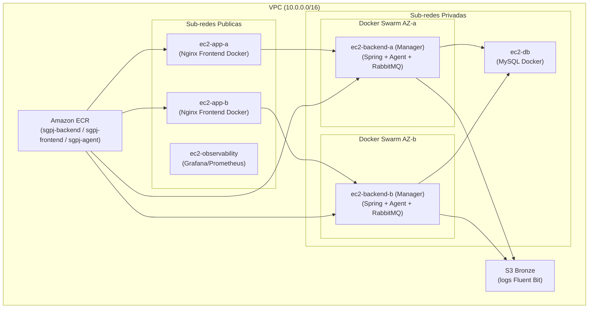
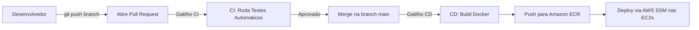

# Guia Definitivo de Execucao e Implantacao da Infraestrutura -- SGPJ

> [!IMPORTANT]
> Este guia foi elaborado para que **qualquer membro do grupo** consiga clonar o repositorio em sua propria maquina (Windows com WSL ou Linux) e subir a infraestrutura completa na AWS com facilidade, sem conflitos ou erros de caminhos fixos.

---

## Visao Geral da Arquitetura

O projeto SGPJ utiliza a seguinte stack de infraestrutura:

| Componente | Tecnologia |
|---|---|
| Orquestracao de containers | Docker Swarm (local por AZ) no Backend + Docker no Frontend e DB |
| Repositorio de imagens | Amazon ECR (3 repositorios: `sgpj-backend`, `sgpj-frontend`, `sgpj-agent`) |
| Frontend | React + Nginx empacotado como imagem Docker no ECR |
| Backend | Spring Boot + RabbitMQ (gerenciados via Docker Swarm Stack) |
| IA Conversacional | Agent MarIA (Python + FastAPI + LangChain + Gemini) |
| Observabilidade | Grafana + Prometheus + Loki + Alertmanager (opcional) |
| Pipeline de Logs | Fluent Bit -> S3 Bronze -> Athena |
| CI/CD & Automacao | GitHub Actions (CI/CD) + Script de Sincronizacao de Secrets automatizado |



---

## 1. Pre-requisitos na Maquina Local

Para executar este projeto, a sua maquina precisa ter instalado:

1. **Git**
2. **AWS CLI v2** configurado com as credenciais do seu laboratorio Vocareum.
3. **GitHub CLI (`gh`)** autenticado (`gh auth login`).
4. **Terraform** (versao 1.5.0 ou superior).
5. **WSL (Ubuntu)** com **Ansible** instalado:
   ```bash
   # Dentro do WSL (Ubuntu):
   sudo apt update
   sudo apt install -y ansible python3-pip
   ```
6. A chave privada do laboratorio AWS Academy (`vockey.pem`).

---

## 2. Preparacao do Ambiente (Passo a Passo)

### Passo 2.1 -- Configurar a Chave SSH (`vockey.pem`)

No AWS Academy, baixe o arquivo `vockey.pem` (ou `labsuser.pem`) e salve-o no diretorio `~/.ssh/` do seu WSL:

```bash
# No terminal WSL:
mkdir -p ~/.ssh
# Copie o arquivo vockey.pem que voce baixou na pasta Downloads do Windows:
cp /mnt/c/Users/$USER/Downloads/vockey.pem ~/.ssh/vockey.pem
# Ajuste as permissoes de seguranca obrigatorias do SSH:
chmod 400 ~/.ssh/vockey.pem
```

---

### Passo 2.2 -- Configurar as Variaveis do Terraform (`terraform.tfvars`)

Dentro da pasta `infra/terraform/`, existe um arquivo de exemplo. Crie a sua copia local:

```bash
cd infra/terraform
cp terraform.tfvars.example terraform.tfvars
```

Abra o `terraform.tfvars` e preencha os valores:

| Variavel | Descricao | Exemplo |
|---|---|---|
| `Key-All` | Nome do par de chaves na AWS | `"vockey"` |
| `auto_run_ansible` | Rodar Ansible automaticamente apos `apply` | `true` |
| `enable_observability` | Subir instancia Grafana/Prometheus | `false` |

> [!NOTE]
> O arquivo `terraform.tfvars` esta no `.gitignore`. Cada membro do grupo precisa criar o seu proprio a partir do `.example`.

---

### Passo 2.3 -- Configurar os Segredos da Aplicacao (`secrets.yml`)

Dentro de `infra/ansible/`, crie o arquivo de segredos a partir do exemplo fornecido:

```bash
cd infra/ansible
cp secrets.yml.example secrets.yml
```

Abra o `secrets.yml` e preencha todas as variaveis sensiveis (JWT, Azure AD OAuth, Gmail App Password, Gemini LLM API Key).

> [!CAUTION]
> **Nunca** commite o `secrets.yml` real. Ele esta no `.gitignore`.

---

### Passo 2.4 -- Configurar Credenciais da AWS no Terminal

> [!WARNING]
> As credenciais do AWS Academy **expiram a cada ~4 horas**. Repita este passo toda vez que abrir uma nova sessao no Vocareum.

1. Va em **AWS Details** -> **AWS CLI** -> copie o bloco de credenciais.
2. Cole no seu terminal PowerShell ou WSL:

```bash
aws configure set aws_access_key_id "SUA_ACCESS_KEY"
aws configure set aws_secret_access_key "SUA_SECRET_KEY"
aws configure set aws_session_token "SEU_SESSION_TOKEN"
aws configure set region "us-east-1"
```

3. Verifique se funcionou:
```bash
aws sts get-caller-identity
```

---

## 3. Primeira Vez -- Criando os Repositorios ECR e Toda a Infraestrutura

> [!NOTE]
> Execute esta secao apenas se for a **primeira vez** que o grupo esta rodando o projeto e os repositorios ECR ainda nao existem na sua conta AWS.

```bash
cd infra/terraform
terraform init
terraform apply -auto-approve
```

### O que o Terraform faz automaticamente:

1. **Cria os repositorios ECR:** `sgpj-backend`, `sgpj-frontend`, `sgpj-agent`.
2. **Sincroniza Secrets & Dispara Builds no GitHub:** Dispara o script `sync-aws-secrets.ps1` que atualiza as credenciais da AWS nos 3 repositorios (Backend, Frontend, Agent) e aciona os workflows de CD para compilar e subir as imagens iniciais no ECR.
3. **Cria a rede completa na AWS:** VPC, Subnets Publicas e Privadas, Internet Gateway, NAT Gateway, Route Tables e Security Groups (incluindo regras para Swarm).
4. **Cria as instancias EC2:**
   - `ec2-app-a` e `ec2-app-b` (Nginx + Frontend React via Docker).
   - `ec2-backend-a` e `ec2-backend-b` (Docker Swarm Manager - Spring Boot + Agent + RabbitMQ).
   - `ec2-db` (MySQL Docker).
5. **Gera os arquivos do Ansible:** Monta dinamicamente os IPs reais no `production.ini` e as variaveis no `all.yml`.
6. **Executa o Ansible (se `auto_run_ansible = true`):**
   - Aguarda o SSH e o `cloud-init` terminarem completamente (sem erros de boot/race conditions).
   - Instala Docker em todas as EC2s.
   - Sobe o MySQL com persistencia e schema.
   - Inicializa o cluster Docker Swarm local no backend e executa `docker stack deploy`.
   - Instala AWS CLI v2 e autentica o Nginx no ECR para rodar o container do frontend React.
   - Configura o Fluent Bit para envio de logs estruturados ao S3 Bronze.

---

## 4. Dia a Dia -- Destruir e Recriar a Infraestrutura

> [!IMPORTANT]
> Os repositorios ECR tem `prevent_destroy = true` para proteger as imagens Docker. Isso significa que `terraform destroy` **vai falhar** se tentar deletar os ECRs. Siga **obrigatoriamente** o fluxo abaixo.

---

### 4.1 -- Para DESTRUIR (fim do dia / economizar creditos)

```powershell
cd infra/terraform

# PASSO 1: Remover os ECRs do estado do Terraform
# (isso NAO apaga os repositorios na AWS, apenas desvincula do estado local)
terraform state rm aws_ecr_lifecycle_policy.agent aws_ecr_lifecycle_policy.frontend aws_ecr_lifecycle_policy.backend aws_ecr_repository.frontend aws_ecr_repository.backend aws_ecr_repository.agent

# PASSO 2: Destruir toda a infraestrutura restante
terraform destroy -auto-approve
```

> [!NOTE]
> Apos o destroy, os repositorios ECR **continuam existindo** na AWS com todas as imagens intactas. Apenas as EC2s, VPC, etc., sao destruidos.

---

### 4.2 -- Para RECRIAR (inicio de nova sessao)

```powershell
cd infra/terraform

# PASSO 1: Atualizar credenciais AWS no terminal (veja Secao 2.4)
# aws configure set aws_access_key_id "..." (etc)

# PASSO 2: Reconectar o Terraform aos ECRs existentes na AWS
terraform import aws_ecr_repository.frontend sgpj-frontend
terraform import aws_ecr_repository.backend sgpj-backend
terraform import aws_ecr_repository.agent sgpj-agent
terraform import aws_ecr_lifecycle_policy.frontend sgpj-frontend
terraform import aws_ecr_lifecycle_policy.backend sgpj-backend
terraform import aws_ecr_lifecycle_policy.agent sgpj-agent

# PASSO 3: Recriar toda a infraestrutura
terraform apply -auto-approve
```

> [!TIP]
> Caso voce queira rodar apenas a sincronizacao de secrets do GitHub e acionar os builds das imagens manualmente a qualquer momento, execute:
> ```powershell
> cd infra/scripts
> .\sync-aws-secrets.ps1
> ```

---

## 5. Fluxo de CI/CD (GitHub Actions)

O deploy de qualquer alteracao no codigo e 100% automatizado:



### O que acontece no CD de cada aplicacao:
- **Frontend:** Build do Vite -> Constroi imagem Docker Nginx contendo os estaticos compilados -> Push no ECR `sgpj-frontend:latest` -> Notifica `ec2-app-a` e `ec2-app-b` via SSM para puxar a nova imagem e reiniciar o container Docker.
- **Backend:** Build Maven (Spring Boot) -> Docker Build -> Push no ECR `sgpj-backend:latest` -> Notifica `ec2-backend-a` e `ec2-backend-b` via SSM para rodar `docker stack deploy` mantendo alta disponibilidade.
- **Agent MarIA:** Docker Build (Python FastAPI) -> Push no ECR `sgpj-agent:latest` -> Notifica os managers do Swarm via SSM.

---

## 6. Observabilidade e Logs

### 6.1 -- Observabilidade (Grafana + Prometheus + Loki)
Se `enable_observability = true`, consulte o IP com:
```bash
terraform output observability_public_ip
```
- **Grafana:** `http://<IP>:3001` (admin / admin)
- **Prometheus:** `http://<IP>:9090`
- **Alertmanager:** `http://<IP>:9093`

### 6.2 -- Pipeline de Logs no AWS Athena
Os logs das aplicacoes, Nginx e SO sao coletados pelo Fluent Bit e gravados no S3 Bronze.
- **Workgroup:** `sgpj-logs-analytics`
- **Database:** `sgpj_logs_bronze`
- Para atualizar particoes no Athena apos subir o ambiente:
```bash
aws athena start-query-execution \
  --query-string "MSCK REPAIR TABLE sgpj_logs_bronze.application_logs;" \
  --work-group sgpj-logs-analytics \
  --region us-east-1
```

---

## 7. Verificacao e Troubleshooting

### 7.1 -- Obter informacoes da infraestrutura
```bash
cd infra/terraform
terraform output
```

### 7.2 -- Acessar as EC2s via SSH
```bash
# Conectar no Frontend (App A - IP publico):
ssh -i ~/.ssh/vockey.pem ubuntu@<IP_PUBLICO_APP_A>

# Conectar no Backend (IP privado a partir do App A):
ssh -i ~/.ssh/vockey.pem ubuntu@<IP_PRIVADO_BACKEND>
```

### 7.3 -- Comandos uteis nas EC2s
```bash
# Na EC2 de Backend (Swarm):
docker service ls
docker stack ps sgpj_backend
docker service logs -f sgpj_backend_backend
docker service logs -f sgpj_backend_agent

# Na EC2 de App (Frontend):
docker ps
docker logs -f nginx
curl -I http://localhost
```

### 7.4 -- Problemas Comuns e Solucoes

| Problema | Causa Provavel | Solucao |
|---|---|---|
| `terraform apply` falha com "ECR already exists" | ECR ja existe na AWS mas nao esta no state | Execute os comandos de `terraform import` da Secao 4.2 |
| `terraform destroy` falha com "prevent_destroy" | Terraform tentando deletar os ECRs protegidos | Execute o `terraform state rm` da Secao 4.1 antes do destroy |
| `ec2-app-a: UNREACHABLE!` ou erro de SSH no Ansible | Instancia recem-criada ainda em fase de boot | O `docker.yml` agora possui wait automatico para SSH e cloud-init, e o `run_ansible.sh` retenta automaticamente |
| `aws: not found` na EC2 de App | AWS CLI nao estava instalado na imagem base | Ja corrigido no role `nginx`, que instala o AWS CLI v2 dinamicamente |
| 502 Bad Gateway no ALB | Backend inicializando ou container reiniciando | Aguarde 1-2 minutos para o Spring Boot subir e validar `/actuator/health` |
