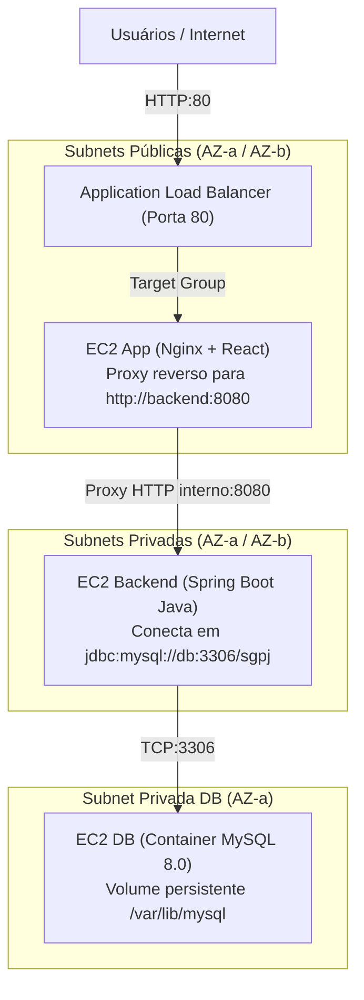
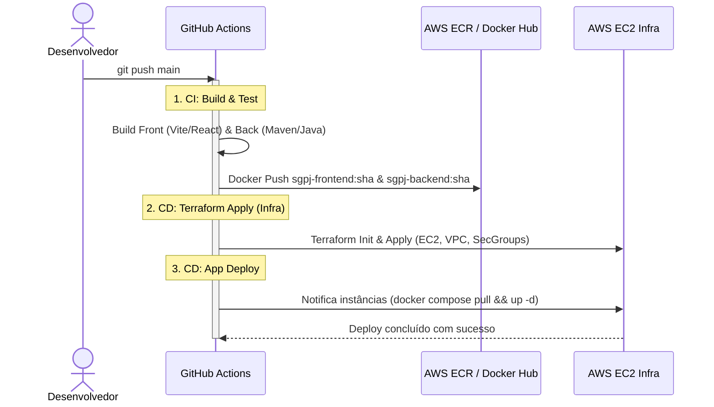

# Plano de Refatoração da Infraestrutura & Pipeline CI/CD

> **Objetivo:** Simplificar a arquitetura, eliminar gargalos de provisionamento (RDS, etapas manuais do Ansible), viabilizar interconexão automática entre camadas (Front → Back → DB) e construir uma esteira automatizada com **GitHub Actions** e repositório de containers (**Docker Hub** ou **AWS ECR**).

---

## 1. Diagnóstico do Estado Atual vs. Estado Desejado

| Aspecto | Como Está Hoje (Problemas) | Como Vai Ficar (Refatoração Proposta) |
| :--- | :--- | :--- |
| **Provisionamento do Banco** | AWS RDS MySQL gerenciado: demora ~15 min para subir, consome cota do Lab/Academy e encarece a infra. | **Container MySQL 8.0** na EC2 `ec2-db` com volume EBS persistente montado. Sobe em menos de 30 segundos. |
| **Configuração de Software** | Playbooks Ansible manuais, inventário com IPs estáticos que quebram ao recriar instâncias, bastion SSH lento. | **Cloud-init / User Data automatizado** injetando `docker-compose` diretamente pelo Terraform via `templatefile`. |
| **Conexão entre Camadas** | Configuração manual de IPs nos arquivos de conf do Nginx e do Spring Boot. | **Descoberta automática via Terraform**: o IP privado do DB é injetado no Back; o IP do Back é injetado no Nginx. |
| **Gestão de Imagens** | Implantação de JAR e HTML avulsos copiados para os servidores. | **Imagens Docker versionadas** no AWS ECR ou Docker Hub (`front:v1.0.0`, `back:v1.0.0`). |
| **Esteira CI/CD** | Múltiplos passos manuais no terminal (Terraform apply → gen_inventory → Ansible). | **GitHub Actions único**: dispara testes, build das imagens Docker, push no registry e deploy automático. |

---

## 2. Decisão Arquitetural: O que fazer com o Ansible?

Você levantou duas opções para simplificar o Ansible:

### Opção 1 (Recomendada): **Arquitetura Imutável via Docker Compose + Cloud-Init (Zero Ansible)**
- **Como funciona:** O Terraform sobe as instâncias já com um script `user_data` (`cloud-init`). Esse script instala Docker, faz login no Docker Hub/ECR, baixa o `docker-compose.yml` (já com as variáveis de ambiente dos IPs privados injetadas pelo Terraform) e sobe os containers.
- **Por que é superior para CI/CD:**
  - Não depende de conexões SSH complexas com ProxyCommand/Bastion no runner do GitHub Actions.
  - A instância nasce 100% pronta sem necessidade de rodar nenhum comando adicional após o `terraform apply`.
  - O deploy de novas versões vira simplesmente um webhook ou um comando simples `docker compose pull && docker compose up -d`.

### Opção 2: **Terraform Orquestrando o Ansible Automaticamente (Modelo Pezão)**
- **Como funciona:** O Terraform usa o recurso `local_file` com `templatefile` para gerar dinamicamente o `hosts.ini` e `all.yml` com os IPs recém-criados. Em seguida, um `null_resource` com `local-exec` executa `ansible-playbook` assim que as EC2 ficam online.
- **Quando usar:** Se a disciplina/faculdade exigir expressamente que a ferramenta Ansible esteja presente na entrega.

---

## 3. Modelo de Infraestrutura e Conectividade Automática



### Como a conexão automática funciona sem hardcode de IP:

1. **Camada DB (MySQL):**
   - A EC2 `db` sobe primeiro e ganha o IP privado (ex: `aws_instance.db.private_ip`).
2. **Camada Backend (Spring Boot):**
   - O Terraform injeta o `db_private_ip` diretamente no `user_data` do Backend:
     ```yaml
     SPRING_DATASOURCE_URL: jdbc:mysql://${db_private_ip}:3306/sgpj
     SPRING_DATASOURCE_USERNAME: root
     SPRING_DATASOURCE_PASSWORD: ${db_password}
     ```
3. **Camada Frontend (Nginx):**
   - O Terraform injeta os IPs privados dos backends (`aws_instance.backend_a.private_ip`, `aws_instance.backend_b.private_ip`) no bloco `upstream` da configuração do Nginx:
     ```nginx
     upstream backend_servers {
         server ${backend_a_ip}:8080;
         server ${backend_b_ip}:8080;
     }
     ```
   - O front faz requisições para `/api/...` e o Nginx encaminha internamente com balanceamento round-robin.

---

## 4. Esteira de CI/CD com GitHub Actions

O fluxo de CI/CD será dividido em dois workflows bem definidos:



---

## 5. Roteiro de Implementação Passo a Passo

### Fase 1: Limpeza e Eliminação do RDS
- [ ] Remover `terraform/rds.tf` (e o db subnet group desnecessário).
- [ ] Criar o script de bootstrap/docker-compose da instância `ec2-db` para subir o container MySQL com inicialização de schema (`schema.sql`).
- [ ] Liberar porta `3306` no Security Group apenas para a subnet do backend.

### Fase 2: Repositório de Containers (Docker Registry)
- [ ] Escolher entre **Docker Hub** (público/privado simples) ou **AWS ECR** (nativo na AWS via Terraform).
- [ ] Criar `Dockerfile` otimizado para o Backend (multi-stage build Java) e Frontend (multi-stage build Nginx).

### Fase 3: Conexão Automática das Camadas no Terraform
- [ ] Criar templates de inicialização (`templates/nginx.conf.tftpl`, `templates/docker-compose.backend.tftpl`).
- [ ] Atualizar o `user_data` das EC2 no `ec2.tf` passando as variáveis dinâmicas através da função `templatefile()`.

### Fase 4: Automação CI/CD no GitHub Actions
- [ ] Criar `.github/workflows/ci.yml` para validação, teste e build de imagens.
- [ ] Criar `.github/workflows/cd.yml` com integração aos secrets da AWS para deploy automático.
- [ ] Adicionar checagem de integridade (*healthcheck*) ao final da pipeline.
